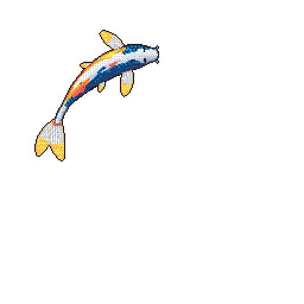
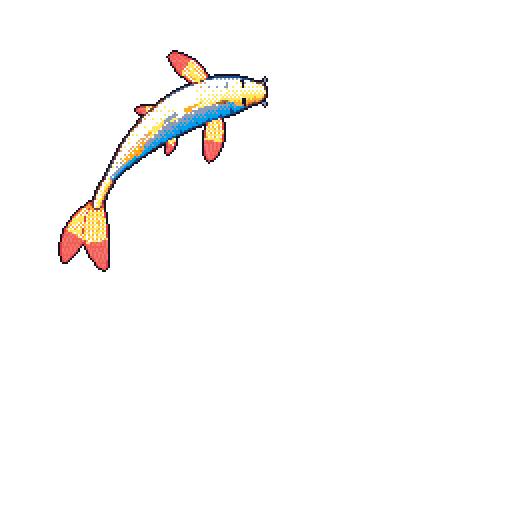
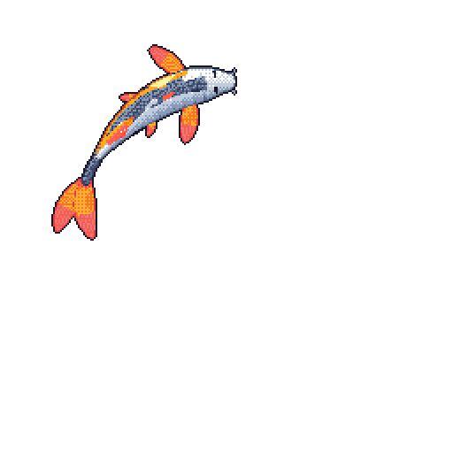
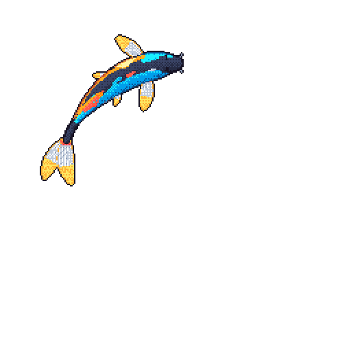
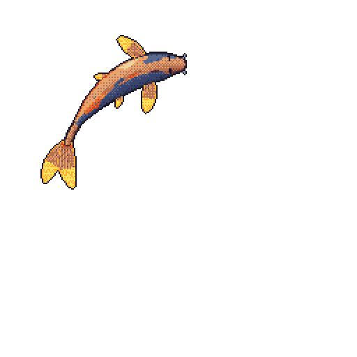
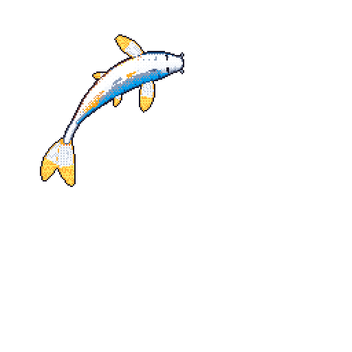

# git-koi-aquarium 🐟

[](https://github.com/marketplace/actions/git-koi-aquarium)
[](https://github.com/reginaldalfret/git-koi-aquarium/releases/latest)
[](https://pkg.go.dev/github.com/reginaldalfret/git-koi-aquarium)
[](https://opensource.org/licenses/MIT)
[-brightgreen?style=flat-square)](https://golang.org)

**git-koi-aquarium** generates an animated, live pixel-art koi pond and dynamic koi fish from your public GitHub activity graph as a self-contained SVG aquarium, looping GIFs, and still PNGs for your GitHub Profile README.

Written in 100% native Go with **zero external dependencies**, leveraging Go's standard library (`image/gif`, `image/png`, `net/http`) for blazing-fast generation in under **0.5s**.

---

<div align="center">
  <a href="https://github.com/reginaldalfret/git-koi-aquarium">
    
  </a>
  <p><em>Live, responsive animated SVG aquarium featuring 12 collision-free native koi across 6 authentic Japanese varieties swimming under floating botanicals.</em></p>
</div>

---

## ⚡ Quick Start (1-Minute Setup)

Add a live animated koi aquarium to your GitHub Profile in two simple steps:

### Step 1: Create the GitHub Action Workflow

In your profile repository (the repository named after your GitHub username, e.g. `username/username`), create `.github/workflows/koi-aquarium.yml`:

```yaml
name: Generate GitHub Koi Aquarium

on:
  schedule:
    - cron: '20 0 * * *' # Automatically runs every night after UTC midnight
  workflow_dispatch:      # Allows running manually anytime from the Actions tab

permissions:
  contents: write

jobs:
  aquarium:
    runs-on: ubuntu-latest
    steps:
      - uses: actions/checkout@v4

      - name: Generate Koi Aquarium
        uses: reginaldalfret/git-koi-aquarium@v1
        with:
          body: aquarium # Generates the 12-fish animated SVG aquarium
          output-dir: koi

      - name: Commit & Push Changes
        run: |
          git config user.name "github-actions[bot]"
          git config user.email "41898282+github-actions[bot]@users.noreply.github.com"
          git add koi/aquarium.svg
          git diff --quiet && git diff --staged --quiet || git commit -m "chore: update daily koi aquarium [skip ci]"
          git push
```

### Step 2: Embed into Your Profile README

Paste this snippet into your `README.md` wherever you want the live aquarium to appear:

```markdown
<div align="center">
  <a href="https://github.com/reginaldalfret/git-koi-aquarium">
    
  </a>
</div>
```

**That's it! 🎉** Every night, the GitHub Action reads your contributions, derives your koi's growth, and updates your personal animated pond.

---

## 🎨 6 Authentic Japanese Koi Varieties

The aquarium and standalone generators feature 6 traditional koi color morphs with rich 32-color palettes:

| Variety | Type | Description | Preview |
| :---: | :---: | :--- | :---: |
| **Kohaku** | `white` | Pure snow-white ground with vibrant crimson/vermillion *hi* markings. |  |
| **Yamabuki** | `gold` | Radiant metallic yellow and warm sunny gold luster across the body and fins. |  |
| **Asagi** | `asagi` | Slate-blue diamond reticulated scale mesh accented with fiery red-orange ventral fins. |  |
| **Karasu** | `black` | Sleek midnight raven-black body with subtle fin-ray definition. |  |
| **Chagoi** | `tea` | Earthy tea-bronze, amber, and warm ochiba autumn tones. |  |
| **Ogon** | `platinum` | Gleaming, reflective platinum-silver pearl giving clean high contrast. |  |

---

## ✨ Features & Architecture

- **100% Collision-Free Movement**: Fish swim across 6 non-overlapping spatial circuits (Perimeter, NW, NE, Center, SW, SE). Paired fish are phased at 180° offsets, ensuring **zero clumsy overlaps** and natural spacing.
- **Natural Kinematics**: $C^1$-continuous Catmull-Rom cubic Bézier splines produce gentle, graceful glides without jerky tangents or rapid 360° spins.
- **Deep Serene Water**: Clean, tranquil midnight-blue aquatic pond bed providing pristine clarity and high-contrast visibility for koi markings.
- **Biological GitHub Activity Mapping**:
  - **Language Distribution** $\to$ Pigment hues (Beni red, Sumi black, Ki yellow, Orenji orange, Ai blue).
  - **Contribution Totals** $\to$ Logarithmic growth curves scaling body length and head proportions.
  - **Streak Continuity** $\to$ *Gin-rin* reflective scale unlocks and luminous fin tips.
  - **Recent Commit Velocity** $\to$ Behavioral states (Surface Feeding, Darts, Rest, or Calm Cruise).
- **Multi-Depth Visual Layering**: Fish swim naturally underneath floating lily pads and pink blooming lotus clusters.
- **Pure Go Performance**: Generates complex animated SVGs and 120-frame GIFs in **under 0.55 seconds** without external dependencies.

---

## ⚙️ Workflow Inputs & Configuration

Configure the action by setting options under `with:` in your workflow:

```yaml
- uses: reginaldalfret/git-koi-aquarium@v1
  with:
    # Target GitHub login (defaults to repository owner)
    login: ${{ github.repository_owner }}

    # Render mode: 'aquarium', 'all', or a single variety ('asagi', 'gold', 'white', 'black', 'tea', 'platinum')
    # Default: 'white'
    body: aquarium

    # Destination folder relative to repository root
    # Default: 'koi'
    output-dir: koi

    # GitHub token for querying public contribution data
    # Default: ${{ github.token }}
    token: ${{ secrets.GITHUB_TOKEN }}
```

### Supported `body` Modes:
- `aquarium`: Generates `koi/aquarium.svg` (the full animated 12-fish pond).
- `all`: Generates `aquarium.svg` **plus** all 6 individual variety folders (`koi/white/koi.gif`, `koi/gold/koi.gif`, etc.).
- Single variety (`white`, `gold`, `asagi`, `black`, `tea`, `platinum`): Generates a standalone `koi.gif`, `koi.png`, and `preview.html`.

---

## 💻 Local CLI Usage

You can also build and run `git-koi-aquarium` directly on your workstation:

```bash
# Clone the repository
git clone https://github.com/reginaldalfret/git-koi-aquarium.git
cd git-koi-aquarium

# Build the binary
go build -o git-koi ./cmd/git-koi
```

### 1. Collect Account Snapshot
```bash
# Collect public contributions, languages, and activity
./git-koi collect octocat --output snapshot.json
```
*(Requires `gh` CLI authenticated with `gh auth login` or a valid `GH_TOKEN` environment variable).*

### 2. Generate the Full Aquarium SVG
```bash
./git-koi aquarium snapshot.json --output-dir ./dist
# Outputs: dist/aquarium.svg
```

### 3. Render Individual Koi Animations
```bash
./git-koi render snapshot.json --output-dir ./dist/asagi --body asagi
# Outputs: dist/asagi/koi.gif, dist/asagi/koi.png, dist/asagi/preview.html
```

---

## 🏗️ Go Packages

- [`pkg/aquarium`](./pkg/aquarium): Full animated SVG aquarium engine, Catmull-Rom spline curves, and collision-free spatial circuits.
- [`pkg/koi`](./pkg/koi): Development derivation, streak tracking, and logarithmic growth curves.
- [`pkg/coat`](./pkg/coat): Pigment clustering, organic spot distribution, and coat variety definitions.
- [`pkg/behavior`](./pkg/behavior): Daily behavioral state machines (Rest, Surface Feeding, Dart, Cruise).
- [`pkg/markings`](./pkg/markings): Streak fin strength, color vibrancy shifts, and Gin-rin scale generation.
- [`pkg/motion`](./pkg/motion): 15 FPS kinematics, spine wave mechanics, and closed-loop swim curves.
- [`pkg/render`](./pkg/render): Native pixel art rasterizer, fin rays, mouth mechanics, and water ripples.
- [`pkg/output`](./pkg/output): 2x nearest-neighbor scaling, bounding-box palette quantization, GIF/PNG encoding.
- [`pkg/history`](./pkg/history): Account snapshots, continuous ISO week normalization, and language share calculations.
- [`pkg/collect`](./pkg/collect): GitHub GraphQL client querying `contributionsCollection` and user repositories.

---

## 📄 License

[MIT License](LICENSE) © 2026 Reginald Alfret V. Based on the original algorithm by [yalongwastaken](https://github.com/yalongwastaken/git-koi).
